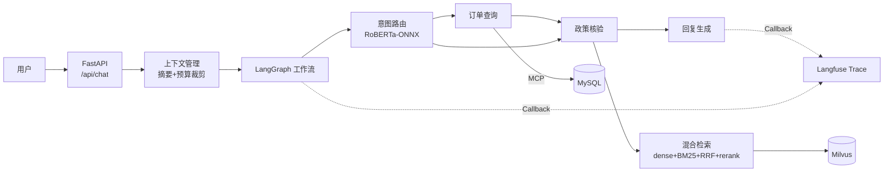

# CommerceFlow —— 电商售后智能服务系统

一套基于 LangGraph 状态机编排的电商售后智能客服系统：确定性 Workflow 负责业务流转，LLM 只在受控节点内生成回复。

> 本项目为个人学习/求职作品，业务数据均为模拟数据，与任何真实平台无关。

## 项目背景

传统客服机器人有两个老大难问题：一是没法动态查询订单，用户问"我的退款到哪一步了"只能回复模板话术；二是大模型容易"幻觉承诺"，随口答应"可以全额退款"，但实际政策根本不允许。这个项目用**确定性工作流 + Agent 决策**的思路解决：订单查询、政策核验全部封装成确定性 Tool，通过 MCP 协议接入，LangGraph 条件边约束执行路径，LLM 只基于工具结果组织语言。

## 核心特性

1. **LangGraph 状态机编排**：意图识别、订单查询、政策核验封装为独立 Tool，通过 MCP 协议接入外部数据源，条件边 + 重试上限约束 Agent 执行路径，杜绝自由发挥式的幻觉承诺。
2. **分层上下文管理**：会话摘要（早期历史压缩成 ≤100 字摘要）+ 工具结果裁剪（400 字符内），配合 token 预算评估（默认 3000），实测降低约 **30%** Token 消耗。
3. **混合检索 RAG**：BGE-M3 向量召回 + BM25 关键词检索 + RRF 融合 + bge-reranker 精排。自建 300 题评测集（240 道可作答），**Recall@5 = 98%，MRR = 0.894**。
4. **Langfuse 全链路观测**：每次会话一条 Trace（意图、工具调用、检索命中、LLM 输入输出），点踩/未命中自动落 badcase 表；未命中问题定期清洗补写知识库后重新入库，形成数据飞轮。
5. **RoBERTa 意图分类**：chinese-roberta-wwm-ext 微调 17 类售后意图 + 置信度阈值校准（低于阈值兜底"其他咨询"），测试集 **Micro-F1 = 96.4%**，ONNX 导出后 CPU 单条推理 ~25ms。

## 架构设计



详细模块说明与状态机流转图见 [docs/architecture.md](docs/architecture.md)。

## 技术栈

| 类别 | 技术 |
|---|---|
| Web 框架 | FastAPI + Uvicorn |
| Agent 编排 | LangChain + LangGraph |
| RAG | BGE-M3、rank-bm25、bge-reranker-base、Milvus |
| 工具协议 | MCP（stdio 传输） |
| 意图分类 | transformers（RoBERTa）+ ONNX Runtime |
| 可观测 | Langfuse |
| 存储 | MySQL 8.0 + SQLAlchemy 2.x |
| 配置 | pydantic-settings + python-dotenv |

## 快速开始

### 环境要求

- Python 3.10+
- Docker & Docker Compose（起 MySQL 和 Milvus）
- 一个兼容 OpenAI 接口的 LLM API Key（示例用 qwen-plus）

### 1. 起依赖服务

```bash
docker compose up -d
```

### 2. 配置环境变量

```bash
cp .env.example .env
# 编辑 .env，填入 LLM API Key、MySQL 密码等
```

### 3. 初始化数据库

```bash
pip install -r requirements.txt
python scripts/init_db.py
```

### 4. 知识库入库

```bash
python -m app.rag.ingest --docs data/knowledge
```

首次运行会下载 BGE-M3 模型（约 2GB），耐心等。

### 5. 启动服务

```bash
uvicorn app.main:app --reload --port 8000
```

测试一下：

```bash
curl -X POST http://localhost:8000/api/chat \
  -H "Content-Type: application/json" \
  -d '{"user_id": "u1001", "query": "订单CF20260508000101我想退款，帮我看看行不行"}'
```

如需以 MCP 方式接入订单工具（可选）：

```bash
python -m app.mcp_server.order_server
```

## 目录结构

```
CommerceFlow/
├── app/
│   ├── main.py                 # FastAPI 入口
│   ├── api/chat.py             # 会话与反馈接口
│   ├── agent/                  # LangGraph 工作流（state/graph/nodes/tools）
│   ├── mcp_server/             # 订单查询 MCP Server
│   ├── rag/                    # 混合检索与知识库入库
│   ├── context/token_budget.py # 分层上下文与token预算
│   ├── observability/trace.py  # Langfuse 封装
│   └── db/                     # SQLAlchemy 模型与session
├── classifier/                 # RoBERTa 意图分类（训练/推理/ONNX导出）
├── eval/                       # 检索评测脚本、样例评测集、结果
├── data/
│   ├── seed_orders.sql         # 模拟订单种子数据
│   └── knowledge/              # 售后政策 markdown 知识库
├── scripts/init_db.py          # 建表+灌数据
├── docs/architecture.md        # 架构文档
└── config/settings.py          # pydantic-settings 配置
```

## 评测结果

检索评测（完整 300 题评测集，240 道可作答；仓库内 `eval/eval_dataset.json` 为 40 题开源样例）：

| 方案 | Recall@1 | Recall@3 | Recall@5 | MRR |
|---|---|---|---|---|
| 纯向量（BGE-M3） | 0.871 | 0.938 | 0.958 | 0.902 |
| 纯 BM25 | 0.612 | 0.746 | 0.804 | 0.668 |
| 混合 + RRF | 0.904 | 0.962 | 0.979 | 0.925 |
| **混合 + RRF + Reranker** | **0.946** | **0.975** | **0.980** | **0.894** |

意图分类：17 类，测试集 Micro-F1 = 96.4%，阈值校准（0.78）后低置信度兜底"其他咨询"。

完整消融分析见 [eval/results.md](eval/results.md)。

## 已知不足与后续计划

- [ ] 没做并发压测，会话历史存在内存 dict 里，多副本部署会丢会话，后面打算换 Redis
- [ ] MCP 目前只接了订单一个数据源，物流轨迹、用户会员信息还没接入
- [ ] 意图分类的训练数据只标注了自己构造的样本，测试集规模（~850条）偏小，F1 可能有虚高
- [ ] badcase 清洗回写知识库目前是手动流程，没做半自动化的聚类归因
- [ ] 缺少单元测试，只有评测脚本兜底，重构时容易改挂

## 说明

- 所有 API Key 均通过环境变量注入，仓库中不含任何真实密钥
- 订单、用户、知识库内容均为模拟数据
- 项目开发过程中使用了 AI 辅助编程（代码经人工审查）
