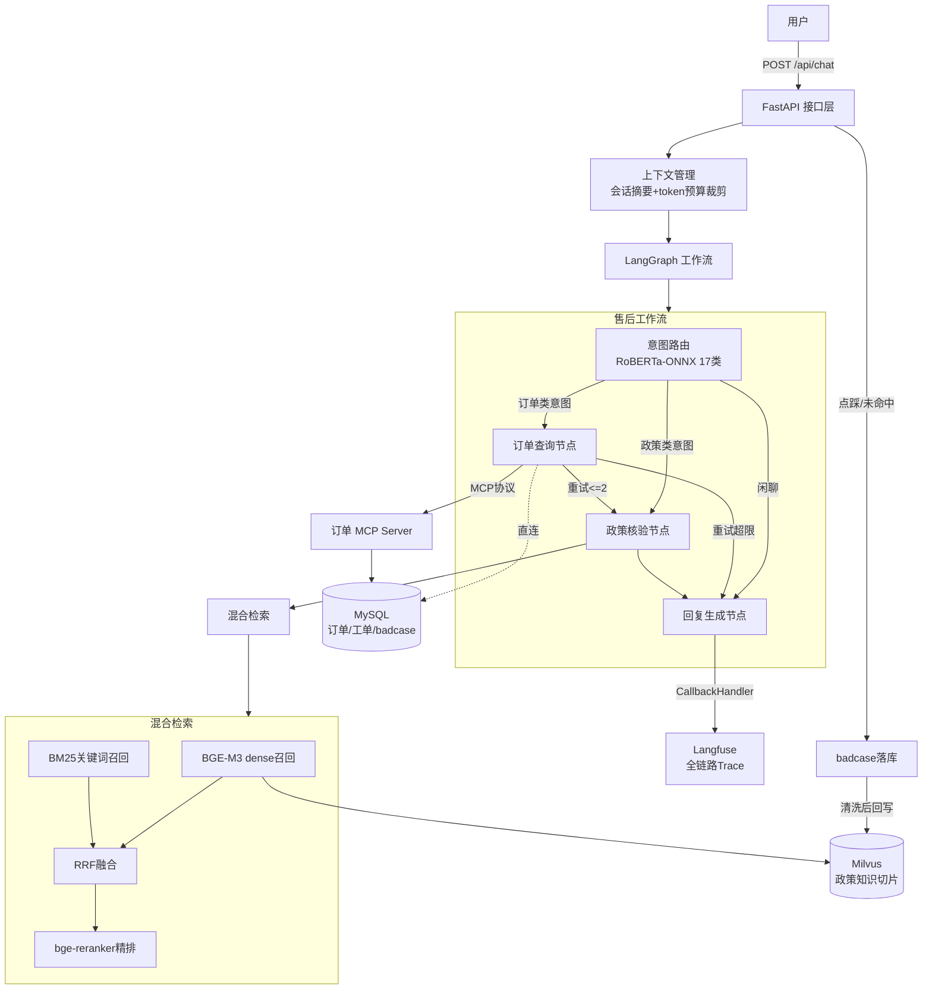
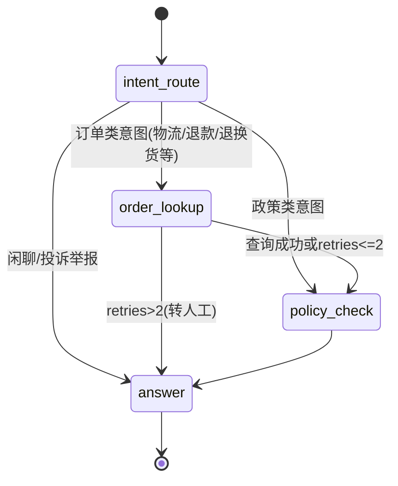

# 架构设计

## 总体架构

## Agent 状态机流转

关键约束：Agent 不是自由发挥的 ReAct 循环，而是**条件边写死的状态机**——每一步能走哪个分支由意图和重试次数决定，LLM 只在最后 answer 节点基于确定性工具结果生成文本，从根上限制"幻觉承诺"。

## 模块说明

| 模块 | 路径 | 职责 |
|---|---|---|
| 接口层 | `app/api/chat.py` | 会话接口、反馈接口、会话内存管理 |
| 工作流 | `app/agent/graph.py` `nodes.py` | LangGraph 状态机编排、条件边、重试上限 |
| 工具 | `app/agent/tools.py` | 订单查询/物流/退款政策核验（查MySQL） |
| MCP | `app/mcp_server/order_server.py` | 把订单工具通过 MCP 协议暴露，stdio 传输 |
| RAG | `app/rag/retriever.py` `ingest.py` | 混合检索链路、知识库切分入库 |
| 上下文 | `app/context/token_budget.py` | 会话摘要、工具结果裁剪、token预算 |
| 观测 | `app/observability/trace.py` | Langfuse trace/score、badcase链接回查 |
| 分类器 | `classifier/` | RoBERTa微调、阈值校准、ONNX导出与推理 |
| 评测 | `eval/` | Recall@K、MRR评测脚本与样例评测集 |

## 数据飞轮

1. 检索未命中或用户点踩 → `badcase_logs` 表落库，带 Langfuse trace 链接
2. 定期人工归因（知识缺失 / 切分不当 / 检索失败）
3. 缺失知识补写 markdown → 重新 ingest 入 Milvus
4. 用 trace 里的高频未命中问法扩充评测集，回归验证 Recall/MRR 不掉

## 上下文分层策略

- **L1 原始对话**：最近 4 轮保留原文
- **L2 会话摘要**：更早历史压缩成 ≤100 字摘要（保留订单号、结论）
- **L3 工具结果**：裁剪到 400 字符内，只留关键字段
- 最后统一过 token 预算（默认 3000），超了从最旧消息开始丢

相比全量拼历史，实测单次请求 token 消耗下降约 30%。
